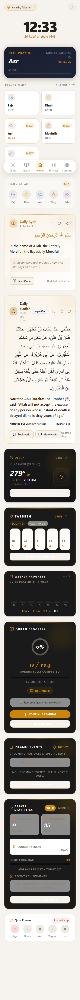
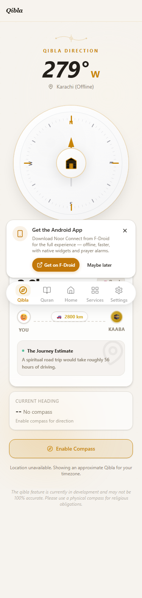
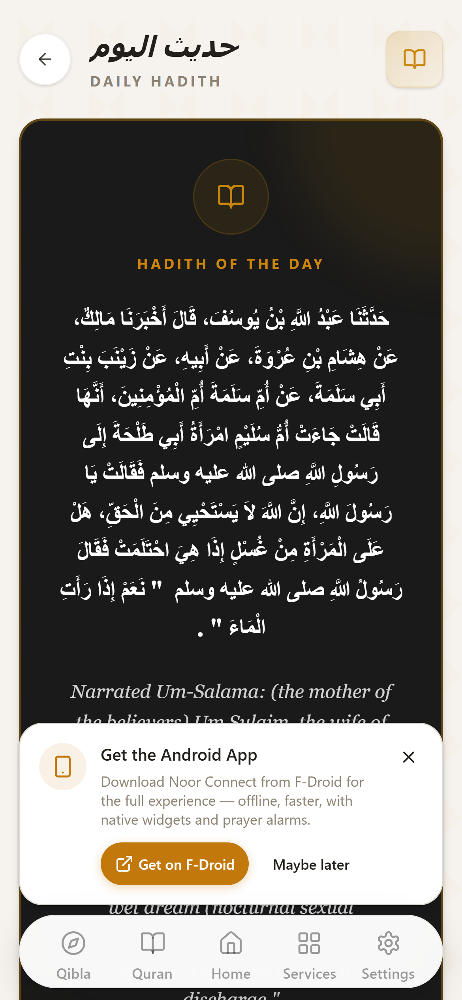
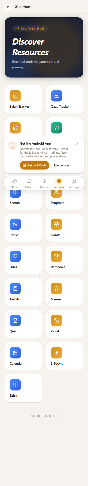
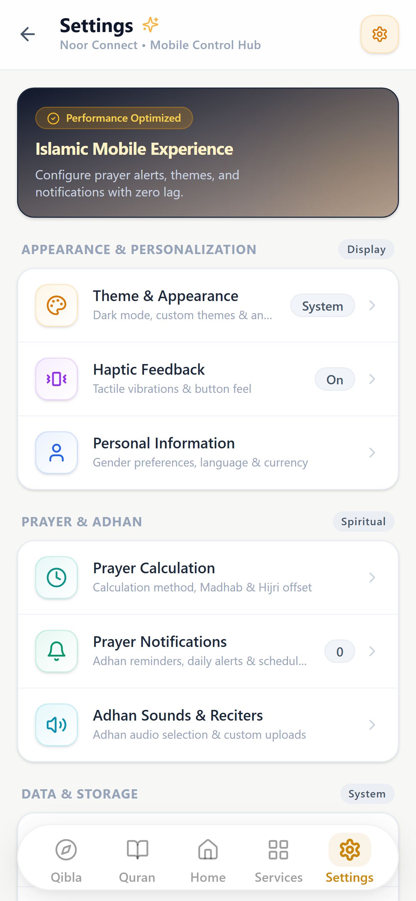
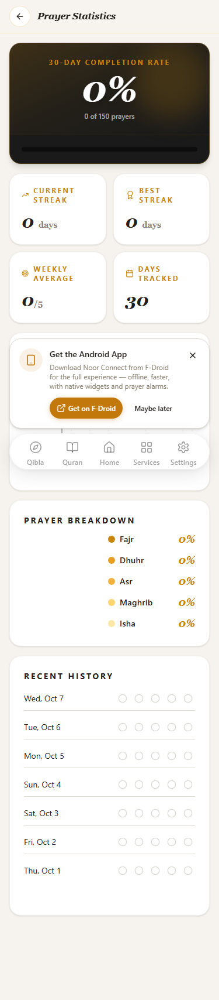

# 🌙 Noor Connect - Your Ultimate Islamic Companion

**License**: GPL-3.0-or-later | **Status**: Stable | **Version**: 2.5.0 | **Privacy-First** | **No Copyright Nasheed Partner**

**Noor Connect** is a comprehensive, privacy-focused Islamic application built as a hybrid Progressive Web App (PWA) with native mobile capabilities. It offers a complete Islamic toolkit without compromising your privacy — no tracking, no analytics, all data stays on your device.

---

## 🎯 Our Mission

Noor Connect was built because there was no single Islamic app that offered comprehensive features without selling user data. Every feature exists because the developer personally needed it, and every architectural decision prioritizes **your sovereignty over your spiritual data**.

### 🏆 Partnership: No Copyright Nasheed

We're proud to partner with **[No Copyright Nasheed](https://nocopyrightnasheed.com/)** — the leading platform for copyright-free Islamic nasheeds.

- ✅ **Official License Grant**: Free perpetual license to integrate the nasheed catalog under the NCN Community License
- ✅ **Official Feature**: Noor Connect is featured on the [No Copyright Nasheed website](https://nocopyrightnasheed.com/) as a trusted partner
- 🎵 **400-track curated library** with a highly optimized audio player

---

## 🆕 What's New in v2.5.0

### 🇹🇷 Turkish Language
- **Full Turkish (Türkçe) translation for all 1,242 app strings**, with native Turkish prayer names (İmsak, Güneş, Öğle, İkindi, Akşam, Yatsı) — 8 languages total

### 📦 ~190 MB Smaller APK
- **Tafsir no longer bundled (−175 MB)**: all editions stream from CDN; per-edition offline downloads from 2.4.0 still available in Settings → Storage
- Dead data removed: a corrupted duplicate hadith dataset (137 MB in the repo) and an orphaned 16 MB legacy file

### 🕌 Prayer Accuracy Fixes
- Adhan alarms survive reboot (the boot receiver was unregistered since 2.3.0)
- Correct times for remote cities — no more timezone-shifted alarms and countdowns
- Gulf Region & Morocco methods use their declared angles (verified to the minute vs the Aladhan API)
- Web adhan notifications fire reliably for all five prayers (was ~3/5)
- Custom adhan audio now works in native background alarms
- Release signing config fixed for the signed-APK CI workflow

### 🌐 i18n Fixes
- Update-dialog placeholders ({version}, {time}) now render real values in every language
- No more English flash on launch — the app opens directly in your language
- User text (search queries, custom adhan names) no longer shows as &#39;/&amp; entities
- 4 missing translations added (PDF audio player, Tafsir history tab) + dead keys removed
- Full audit: every string in all 8 languages verified to render correctly

### 📥 Tafsir Downloads
- **Android progress notification**: appears when a tafsir download starts, updates live ("37/114 · 12 MB"), disappears when done, cancelled or deleted
- Deleting a tafsir now actually deletes it — even mid-download, even in the reader
- Progress survives leaving the Storage page; partial downloads show honestly (n/114) and resume

### 🛡️ Backup & Restore
- Fixed a data-loss race where backgrounding mid-restore could overwrite your backup with half-restored data
- Restore failures now show an error in the dialog instead of failing silently

---

## 🗂️ Feature Index

| Feature Area | One-line Summary | Documentation |
|--------------|------------------|---------------|
| 🏠 Home Dashboard | Prayer check-ins, next-prayer countdown, daily ayah & hadith | [Home Dashboard](#home-dashboard) |
| 📖 Quran Reader | 604-page Madani Mushaf, 114 surahs, bookmarks, continue reading | [Quran Reader](#quran-reader-madani-mushaf) |
| 🌐 Tafsir | 27 commentary editions in 6 languages, 3 bundled offline | [Tafsir Library](#tafsir-library) |
| 🎧 Quran Audio | mp3quran.net reciter directory, offline surah downloads, global mini-player | [Quran Audio and Downloads](#quran-audio-and-downloads) |
| 📊 Quran Progress | Page-based progress (X/604), streaks, achievements, bookmarks & notes | [Quran Progress and Streaks](#quran-progress-and-streaks) |
| 📻 Quran Radio | 158 reciter & content stations in 9 categories with listening stats | [Quran Radio](#quran-radio) |
| 📺 Live Streams | Makkah & Madinah 24/7 via the official SBA CDN with auto-fallback | [Live Streams: Makkah and Madinah](#live-streams-makkah-and-madinah) |
| 🎵 Nasheeds | 400 licensed tracks, offline cache, artist filters, shuffle | [Nasheed Library](#nasheed-library) |
| 🕌 Prayer Times | Offline calculation, 13 methods, Aladhan fallback, end times, optional times | [Prayer Times Engine](#prayer-times-engine) |
| 📢 Adhan | Per-prayer adhan, 6 muezzin recordings, custom MP3 upload, native Android alarms | [Adhan System](#adhan-system) |
| 🔔 Notifications | Tahajjud, Duha, fasting, bedtime, Ramadan & event reminders with action buttons | [Notification Suite](#notification-suite) |
| 🕘 Notification History | Filterable log of every notification the app has shown | [Notification History](#notification-history) |
| 🧭 Qibla | Native magnetometer compass with declination correction and web fallback | [Qibla Compass](#qibla-compass) |
| 📅 Islamic Calendar | Hijri dates, event countdowns, Eid celebration overlay | [Hijri Calendar and Islamic Events](#hijri-calendar-and-islamic-events) |
| 🌙 Ramadan Mode | Fasting log, Suhoor/Iftar countdowns, Taraweeh tracker, charity & deeds | [Ramadan Mode](#ramadan-mode) |
| 🌸 Noor Cycle | Cycle tracking with pregnancy mode, fiqh engine, dhikr counter, self-care | [Noor Cycle](#noor-cycle-womens-wellness) |
| 🕌 Salah Tracker | Time-validated prayer check-ins, streaks, weekly charts | [Salah Tracker and Prayer Statistics](#salah-tracker-and-prayer-statistics) |
| ⏳ Qaza Tracker | Ledger of missed prayers with daily goals and auto-sync | [Qaza Tracker](#qaza-tracker) |
| 🎯 Habit Tracker | Spiritual habits with streaks, stats and custom habits | [Habit Tracker](#habit-tracker) |
| 📿 Digital Tasbeeh | 5 dhikrs, Zen Mode, lifetime totals, haptic ticks | [Digital Tasbeeh](#digital-tasbeeh) |
| 🤲 Duas | 140 authentic supplications in 35 categories with audio & counters | [Duas and Supplications](#duas-and-supplications) |
| ✨ 99 Names | Asma-ul-Husna with meanings, descriptions and favorites | [99 Names of Allah](#99-names-of-allah) |
| 🧠 Islamic Quiz | 229 verified questions, 5 game modes, XP, lives, mystery boxes | [Islamic Quiz](#islamic-quiz) |
| 🌿 Islamic Remedies | Mood-based Tibb-e-Nabawi index with 96 remedies | [Islamic Remedies (Tibb-e-Nabawi)](#islamic-remedies-tibb-e-nabawi) |
| 📚 E-Books | 272-book library, PDF reader, offline downloads, collections | [E-Books Library](#e-books-library) |
| 📜 Seerah | Ar-Raheeq Al-Makhtum in 33 story chapters with progress tracking | [Seerah of the Prophet (Peace Be Upon Him)](#seerah-of-the-prophet-peace-be-upon-him) |
| 📖 Qisas | Complete stories of all 25 prophets, from Adam to Muhammad ﷺ | [Qisas Al-Anbiya (Stories of the Prophets)](#qisas-al-anbiya-stories-of-the-prophets) |
| 📚 Hadith | 87,000+ hadith across 16 collections with bookmarks | [Hadith Encyclopedia](#hadith-encyclopedia) |
| 💰 Zakat | Gold & silver nisab with live prices and offline fallbacks | [Zakat Calculator](#zakat-calculator) |
| 🧮 Fitrana | Per-family-member Zakat al-Fitr with multi-currency support | [Fitrana Calculator](#fitrana-calculator) |
| ☑️ Eid Checklist | Preparation checklists for Eid al-Fitr and Eid al-Adha | [Eid Checklist](#eid-checklist) |
| 🎛️ Services Hub | One-tap launcher for every feature, with seasonal cards | [Services Hub](#services-hub) |
| 🔐 Backup & Data Safety | Auto-backup every 20 minutes, one-tap restore, update safety | [Backup, Restore and Data Safety](#backup-restore-and-data-safety) |
| 🌍 Languages | 7 languages with full RTL, locale-aware formatting | [Languages and Accessibility](#languages-and-accessibility) |
| ⚙️ Settings | 12 modular settings sections, gender profiles, haptics | [Settings and Personalization](#settings-and-personalization) |

---

## ✨ Features

### Quran & Recitation

#### Home Dashboard
The dashboard is the app's daily cockpit. It combines a premium Spotify-inspired layout with the tools you touch every morning: a greeting that adapts to the time of day, the Islamic date header, a location card with city search, and the full prayer-time grid with a gold **NEXT** pill marking the actual upcoming prayer.

- **One-tap prayer check-in**: mark Fajr–Isha as prayed directly from the dashboard. Check-ins are time-validated against today's calculated times — you cannot check in before the prayer time has entered, and missed prayers are automatically offered to the Qaza tracker.
- **Daily Ayah & Daily Hadith**: a Qur'anic verse and an authentic hadith refresh every day, selected by a non-repeating picker so you don't see the same content twice in a row, with share and copy support.
- **Seasonal overlays**: Eid Mubarak celebration overlay, festive popups for Islamic occasions, and a salam greeting animation you can disable in settings.

#### Quran Reader (Madani Mushaf)
The entire Holy Qur'an is rendered as the standard **604-page Madani Mushaf** — high-quality WebP page images (810×1145, compressed at build time) rather than re-typeset text, so line breaks, page numbers and ayah markers match the printed mushaf exactly.

- **All 114 surahs** with Arabic names, English names and translations, ayah counts, and Meccan/Medinan classification. Search by name, filter by revelation type, and jump straight back in with the **Continue Reading** card that remembers your last page.
- **Smart paging**: each surah maps to its correct mushaf page range (with proper +2 image offset), pages preload ahead of your scroll, and a memory + disk cache keeps revisits instant even on low-end devices.
- **Bookmarks**: bookmark any surah with one tap; bookmarks persist locally and are included in backups.
- **Chunked progressive rendering** keeps scrolling smooth on 2016-era hardware, and a transition-optimized surah list keeps navigation snappy.
- Fully offline: once the mushaf images are on the device, reading requires no network at all.

#### Tafsir Library
A dedicated Tafsir page opens any surah with the **Uthmani-script Arabic text and Sahih International English translation** (fetched from the alquran.cloud API), then layers classical and contemporary commentary under every ayah.

- **27 tafsir editions in 6 languages**: 10 English (Ibn Kathir abridged, Al-Jalalayn, Al-Qushairi, Maarif-ul-Quran, Kashani, Al-Tustari, Asbab Al-Nuzul, Ibn Abbas, Kashf Al-Asrar, Tazkirul Quran), 8 Arabic (Ibn Kathir, Al-Saddi, Al-Baghawi, Tanwir al-Miqbas, Al-Wasit, Al-Tabari, Muyassar, Al-Qurtubi), 4 Bengali, 3 Urdu, 1 Russian and 1 Kurdish edition.
- **Offline editions bundled**: Tafsir Ibn Kathir ships inside the app in English, Arabic and Urdu as local JSON, so commentary on those three works works with zero connectivity; all other editions stream from the spa5k tafsir API on jsDelivr.
- **Whole-tafsir downloads per author**: any edition can be downloaded completely (all 114 surahs) in one tap from Settings → Storage — with honest progress (surah n/114 plus real megabytes, not estimates), resume support (already-stored surahs are skipped), cancel, a true on-disk size once finished, and per-author delete. A downloaded edition then reads **fully offline** in the Tafsir reader — the reader serves it from the on-device store first, preserving exact ayah boundaries, and still layers the Arabic text and translation when a connection is available.
- **Robust parsing**: the tafsir service normalizes many payload shapes (strings, keyed objects, per-ayah records) so editions from different sources render consistently, with graceful fallback from local file to API.

#### Quran Audio and Downloads
Listen to the full Qur'an from the **mp3quran.net reciter directory** — a live, growing catalog of reciters with murattal and mujawwad styles, shown with a live count in the app rather than a hard-coded list.

- **Browse and search reciters**, star favorites, and set a default reciter that's remembered across sessions (default: Mishary Rashid Alafasy).
- **Surah-level MP3 streaming** with a Spotify-style player page: dark hero card, horizontal reciter carousel with avatar images, animated equalizer on the playing row, and sticky search.
- **Offline downloads**: any surah from any reciter can be downloaded to IndexedDB for offline listening. The download manager tracks per-reciter storage usage and supports a one-tap "wipe downloads" action.
- **Global mini-player**: the GlobalQuranPlayer follows you across the whole app with play/pause, seek ±10s, a progress bar, a repeat-one loop toggle, background playback on Android, and lock-screen controls via the Media Session API.

#### Quran Progress and Streaks
Reading progress is tracked **page-based, not ayah-based**: the app measures how many of the mushaf's 604 pages you have read and reports your percentage against that real target.

- **Surah-aware tracking**: a surah only counts as completed when every one of its ayahs has been read, so the "Surahs fully Completed" figure is honest.
- **Reading streaks**: current and longest consecutive-day streaks, total days read, and streak-reset detection when you return after days away.
- **Achievements**: unlockable milestones from first surah through 25/50/75 surahs to a complete Qur'an read, plus 7-day and 30-day streak badges.
- **Bookmarks and notes** are stored alongside progress and flow into the backup system, so your reading state survives reinstalls.

#### Quran Radio
A 24/7 streaming radio catalog of **158 stations** (22 flagship + 136 extended) covering **9 categories**: reciters, surah, tafsir, hadith, adhkar, fatwa, mosque, stories, and translations — sourced from the qurango.net radio backends with per-station artwork.

- **Browse by category chips**, search by name, pin favorite stations to the top, and start with curated **featured stations**.
- **The GlobalRadioPlayer mini-player** keeps audio running while you use other parts of the app.
- **Every second of listening is recorded** per station (sessions, total time, last-listened), feeding the Radio Statistics page.

#### Live Streams: Makkah and Madinah
Watch the Haramain live around the clock via the **official Saudi Broadcasting Authority (SBA) streams** delivered on the Globecast/Akamai CDN — HTTPS and CORS-enabled so the same URLs work in the PWA and the Android APK.

- **Automatic source fallback**: if the primary Makkah stream fails, the player switches once to a secondary 1080p source before showing a friendly retry screen.
- **Adaptive playback with hls.js**: aggressive ~120-second buffering for weak networks, a quality picker (Auto/320p/480p) that appears only when multiple levels exist, and a hard-capped recovery loop so a bad connection can never freeze the OS.
- **True fullscreen on Android**: native `requestFullscreen` with landscape orientation lock, edge-to-edge rendering, and clean restore when you exit.
- Live Makkah/Madinah watch time is folded into the same statistics engine as radio listening.

#### Nasheed Library
**400 curated, legally licensed nasheeds** from No Copyright Nasheed under the NCN Community License — vocal-only Islamic music you can enjoy without copyright guilt.

- **Browse by artist** with quick filter chips, search the catalog, and shuffle your queue (Fisher–Yates shuffle with your current track pinned).
- **Offline-first cache**: tracks you play are cached for offline listening with a ~200-track, 90-day, quota-safe retention policy and visible cache-status indicators per track; you can also clear the cache from storage settings.
- **Animated equalizer visualizer**, a global mini-player, and Media Session lock-screen controls make it a proper listening app.
- The full catalog ships in the app bundle (`src/data/nasheeds.json`), so browsing works even before anything streams.

### Prayer & Daily Worship

#### Prayer Times Engine
Prayer times are calculated **fully offline on-device** using the battle-tested `adhan` library — no API call is needed to know when to pray.

- **13 calculation method presets**: Muslim World League, ISNA, Egyptian General Authority, Umm Al-Qura (90-minute Isha interval), University of Islamic Sciences Karachi, Gulf Region, Kuwait, Qatar, Singapore (MUIS), Turkey (Diyanet), Tehran Institute of Geophysics, and Morocco — each with its exact Fajr/Isha angles or intervals.
- **Smart defaults by region**: before you pick anything, the app recommends the method used in your part of the world (e.g. Umm Al-Qura for Saudi Arabia, Egyptian for Egypt, ISNA for North America) so times match your local mosques.
- **Asr madhab selector**: choose Standard (Shafi'i, Maliki, Hanbali) or Hanafi for the afternoon shadow calculation.
- **Aladhan API fallback**: when online, monthly calendar data from Aladhan (with the equivalent method ID) is cached in localStorage as a cross-check and fallback source.
- **Prayer end times**: every prayer shows when its window ends (Fajr ends at sunrise, Dhuhr at Asr, and so on), plus optional times — Ishraq, Duha and Tahajjud — behind an "Extra prayers" toggle on the home prayer card. On Friday the Dhuhr card reads "Jumma" and ends 90 minutes after start.
- **12/24-hour formatting** follows your preference and locale everywhere times are shown.

#### Adhan System
The adhan is a first-class citizen, on web and natively on Android.

- **6 bundled muezzin recordings** (Makkah, Madinah, Egyptian, Classic, TV Quran, and the Noor Connect adhan) plus a dedicated **Fajr-special adhan**, selectable per taste.
- **Granular per-prayer toggles**: enable or disable the adhan for Fajr, Dhuhr, Asr, Maghrib, Isha and Jummah independently.
- **Custom adhan upload**: add your own MP3 (up to 10 MB per file, stored in IndexedDB) and manage a library of custom adhans; assign one as your adhan.
- **Playback controls**: master volume, override silent mode, play at max volume, and vibration.
- **Native Android pipeline**: exact alarms via a custom `NativeAdhanScheduler`, a foreground `AdhanPlaybackService` with `PARTIAL_WAKE_LOCK` so aggressive battery managers can't cut playback short, automatic notification dismissal when the adhan ends, re-scheduling after reboot via a boot receiver, and a battery-optimization helper that guides you to exempt the app on Lenovo/Samsung/Xiaomi tablets.

#### Notification Suite
A rich local-notification engine (no push server, nothing leaves your phone) keeps you on your deen throughout the day:

- **Prayer notifications with quotes**: each prayer notification carries rotating quotes from the Qur'an and authentic hadith, with **action buttons** — ⏹ Stop Adhan and 🕌 Open App — on both native Android and PWA notifications.
- **Prayer End Reminder**: an optional alert a few minutes before each prayer's valid time ends ("Asr ends in 15 minutes") — one-tap switch on the Profile page, lead time selectable (10/15/20/30 min) under Settings → Notifications; end boundaries follow the fiqh rule shown on the home cards (Fajr → sunrise, others → next prayer, Isha → Islamic midnight / dawn for Hanafi). Fully local scheduling, localized in all 7 languages.
- **Night & day sunnah reminders**: Tahajjud prompts during the last third of the night, mid-morning Salat al-Duha alerts, Monday & Thursday sunnah-fasting reminders, an evening daily-Quran tilawat goal nudge, and bedtime Azkar (Ayatul Kursi and the protection surahs) plus rotating Islamic sleep reminders anchored to your Isha time.
- **Friday Kahf reminder**, daily ayah/hadith, dhikr reminders, and morning/evening adhkar notifications.
- **Ramadan**: Suhoor and Iftar countdown notifications (deterministic IDs so they update in place, and a boot-time safety clear that sweeps away ghost reminders outside Ramadan).
- **Islamic events**: Eid al-Fitr, Eid al-Adha, Laylat al-Qadr, Arafah and more are scheduled automatically with a 30-day lookahead driven by the Hijri calendar service.
- **Women's notifications** (when Noor Cycle is active): fertile-window nudges and a smart Sunday-evening Qaza fasting reminder during Tuhr.
- **Seasonal prompts**: the Eid Checklist and Fitrana Calculator surface as notifications in their seasons (last third of Ramadan and the Eid windows).
- On Android 14+, notifications use a proper white-on-transparent icon and a dedicated notification channel.

#### Notification History
Every notification the app has fired is recorded to a local history store (via the service worker) and presented in a gallery page with **type filters, search, and management actions** — so you can see what you missed and when, even if you dismissed something in a hurry.

#### Qibla Compass
A high-precision Qibla finder that works from great-circle math to the Kaaba's exact coordinates (21.4225°N, 39.8262°E).

- **Native magnetometer pipeline on Android** with 60fps-interpolated heading, a Madgwick sensor fusion filter, and figure-8 calibration UX; a **web fallback** (device-orientation based) takes over when native sensors aren't available.
- **Magnetic declination correction** (because compasses point at magnetic, not true, north): a 24-hour cached value, then a CORS-safe geomagnetic API, then an embedded WMM-lite approximation (±0.5°) that always works offline; a NOAA WMM helper is included for online precision.
- **Guidance beyond the needle**: distance to the Kaaba, cardinal direction, device-orientation and metal-interference warnings, and a Kaaba-alignment glow when you're on target — all rendered as a smooth SVG compass dial.
- A **quick Qibla widget** on the dashboard gives you the bearing at a glance.

#### Hijri Calendar and Islamic Events
A full Islamic calendar page with Gregorian↔Hijri pairing and automatic event tracking.

- **Hijri date engine** with offset adjustments, and a maghrib-anchored Islamic date so "today" flips at sunset the way the Islamic day actually does.
- **Event countdowns** for Ramadan, Laylat al-Qadr, Eid al-Fitr, Eid al-Adha, the Day of Arafah, Islamic New Year, Ashura and more, with Gregorian dates resolved per year.
- **Event notifications** are scheduled up to 30 days ahead, and Eid arrival triggers a celebration overlay across the app.

#### Ramadan Mode
A Ramadan command center that consolidates the month's acts of worship on one page.

- **Suhoor/Iftar countdowns** with a live ticking banner driven by your calculated (or Aladhan-fetched, Imsak-aware) times.
- **Fasting log**: mark each fasted day and watch your month fill in.
- **Qur'an goal**: set a daily page target against the full 604-page mushaf and track your Khatm progress.
- **Taraweeh tracker**: check off the nights you prayed.
- **Charity ledger and daily good-deeds counter**, plus an Eid countdown.
- **Hydration reminders** after Iftar (toggleable), and Suhoor/Iftar notifications with automatic cleanup once Ramadan ends.

### Spiritual Tracking

#### Salah Tracker and Prayer Statistics
Your five daily prayers, tracked honestly.

- **Time-validated check-ins** from the dashboard: a prayer can only be marked after its time has entered, and check-ins before that window are rejected with a clear message instead of being silently accepted.
- **Streaks** (including 5/5-day perfect days) with automatic reset detection when you return after an absence.
- **Statistics page**: weekly bar charts and per-prayer pie charts (Recharts, rendered only when your device can handle it), weekly averages, and a 7-day history table.
- **Missed-prayer bridge**: prayers that were never checked in are automatically detected and offered to the Qaza tracker from the home screen.

#### Qaza Tracker
A careful ledger for making up missed (qaza) prayers.

- **Per-prayer counters** for Fajr, Dhuhr, Asr, Maghrib and Isha — add, complete, or set exact counts.
- **Daily goal** with a progress bar so a mountain of qaza becomes a walkable path, plus a completion history log.
- **Auto-sync** from the Salah tracker: missed prayers detected at day's end flow straight into your qaza ledger.
- Qaza counting **pauses automatically during haidh/nifas** when Noor Cycle is active, and turns back on when your cycle ends.

#### Habit Tracker
Build consistency on the sunnahs that matter to you.

- **Sensible defaults out of the box**: Quran Reading, Fajr Prayer on time, Morning & Evening Adhkar, Giving Charity and more — each with its own icon, color, category and target count.
- **Custom habits**: add your own with targets and units; hide defaults you don't want.
- **Streaks and statistics** per habit, a dashboard widget showing today's habits, and completion history that feeds the backup system.

#### Digital Tasbeeh
A focused dhikr counter designed for flow.

- **5 built-in dhikrs** — SubhanAllah, Alhamdulillah, Allahu Akbar, La ilaha illallah, Astagfirullah — each with Arabic, transliteration and meaning.
- **Zen Mode**: a full-screen, distraction-free overlay where any tap counts and a long-press exits.
- **Lifetime totals** and session counts with haptic ticks on every tap, and a quick-counter widget on the dashboard that stays in sync with the main page.

#### Noor Cycle (Women's Wellness)
A complete, fiqh-aware cycle tracker (route: `/noor-cycle`, visible for female profiles) built around a unified `haidh-tracker-v2` engine with **seven tabs**: Today, Calendar, Log, Stats, Fiqh, Knowledge, and Settings.

- **Madhab-aware rules**: minimum/maximum haidh and nifas days per the Hanafi (3–10 days), Maliki, Shafi'i and Hanbali schools, with automatic **istihadhah detection** when bleeding exceeds your madhab's limits.
- **Phase engine**: haidh, tuhr, premenstrual and fertile phases with fertile-window tracking and ovulation-day insights; flow intensity, mood, pain-scale (1–10) and symptom logging (cramps, headache, fatigue and more) per day.
- **Pregnancy Mode**: a 40-week progress ring, weeks + days, trimester badge and due-date countdown (Naegele's rule, 280 days), du'as of pregnancy and birth, honest fiqh notes (pregnancy bleeding = istiḥāḍah, prayers continue), and a one-tap "Baby arrived" handoff that starts Nifās and pauses prayer alerts. Starting pregnancy never destroys cycle data, and predictions pause while expecting.
- **App-wide fiqh integration**: during haidh/nifas the app automatically silences prayer notifications, halts qaza auto-sync, and adjusts quiz streak logic; a smart Sunday reminder helps you plan making up missed Ramadan fasts.
- **Knowledge tab**: 50 curated fiqh Q&As (ḥayḍ, nifās, istiḥāḍah and the worship around them) with madhab-difference notes and a "Source" chip per answer that opens the exact verified IslamQA.info page; searchable, category-filterable, following the app language where translations exist (Bengali complete).
- **Tap-to-count dhikr counter** in the Fiqh tab with per-dhikr goals (33/33/34/100), daily totals and automatic daily reset; a **daily water tracker** (8 glasses) and a phase-aware self-care card (hydration, iron-rich and sunnah foods with cited sources, sleep, movement, self-compassion).
- **One-tap flow quick-log**: while a period is active, a "Today's Flow" card on the Today tab saves the day's flow (None / Spotting / Light / Medium / Heavy) in a single tap with a light haptic — the most frequent entry no longer requires opening the Log tab. **Ending a period asks for a confirming second tap** (3-second window), so an accidental touch can't end your cycle.
- **Ghusl checklist**, missed-fast tallying (increment, decrement, mark-as-made-up), cycle analytics with charts, and a **PDF doctor report** export (jsPDF) you can hand to a clinician.
- Everything is stored locally under a single storage key and included in backups.

### Knowledge & Library

#### Hadith Encyclopedia
A serious hadith library, fully offline: **16 collections totalling 87,000+ hadith** shipped as gzip-compressed JSON and decompressed on-device via the `DecompressionStream` API (95 MB of raw JSON → under 20 MB in the APK).

- **The collections**: Sahih al-Bukhari (14,769), Sahih Muslim (14,966), Sunan an-Nasa'i (11,399), Sunan Abi Dawud (10,547), Jami' at-Tirmidhi (8,002), Sunan Ibn Majah (8,685), Muwatta Malik (3,715), Sunan ad-Darimi (3,406), Mishkat al-Masabih (5,319), Musnad Ahmad (1,374), Bulugh al-Maram (1,767), Riyad as-Salihin (1,217), Al-Adab Al-Mufrad (1,326), Ash-Shamail al-Muhammadiyya (402), the Forty Hadith (122) and Hisn al-Muslim index entries — with book/chapter structure and collection metadata (total hadith, total books).
- **Comfortable reading**: paged lists of 300 with infinite scroll, debounced search, Arabic + English translation, source/grade display, copy-with-toast and share on every hadith.
- **Bookmarks**: a dedicated Hadith Bookmarks page with bookmark buttons on every hadith screen, persisted locally and covered by backups.

#### Duas and Supplications
**140 authentic du'as across 35 categories** — every entry sourced from the Qur'an or the six canonical hadith collections, spanning Morning, Evening, Travel, Eating, Sleeping, Illness, Distress, Protection, Rizq, Wudu, Dressing, After Adhan, Anxiety & Grief, Guidance & Steadfastness, Laylatul Qadr, Istikharah and more.

- **Search** across all duas, **favorites**, and one-tap **share**.
- **Audio playback** of each du'a via device text-to-speech, so you can learn the pronunciation.
- **Repetition counter** built into each du'a card for after-prayer and morning/evening routines.
- **Du'a of the Day** highlighted on the page top, picked without repeats.
- The 35 category chips scroll horizontally on every screen size (fixed in v2.4.0).

#### 99 Names of Allah
The complete Asma-ul-Husna: all **99 Names with Arabic script, transliteration, meaning and a short description** of each Name's significance. Debounced search finds a Name fast, favorites let you keep the Names you're memorizing close, and the list renders smoothly even on low-end devices.

#### Islamic Quiz
A gamified quiz built to make knowledge stick, with **229 questions across 14 categories** (Qur'an, Hadith, Fiqh, Aqeedah, Pillars, Prayer, Prophets, Sahabah, Seerah, History, Ramadan, Angels, Arabic, Tafsir).

- **Verified content**: every question's answer is grounded in the Qur'an or authentic hadith collections — explanations cite the exact reference (e.g. Bukhari 1896, Muslim 810, Quran 33:40), from "the gate of Paradise for those who fast (Ar-Rayyan)" to "the 17 fard rakats of the day" and "the four sacred months".

- **5 game modes**: Classic (scored run), Daily (a fresh daily challenge), Category drills, **Time Attack** (answer as many as possible in 2 minutes) and **Survival** (endless until your first mistake).
- **XP economy**: 10 XP per correct answer with combo-streak and accuracy bonuses, levels with titles, and a persistent daily-streak system.
- **Lives**: start each session with 5 hearts that regenerate over time — or refill instantly for 100 XP.
- **Mystery boxes**: common/rare/epic/legendary boxes (plus a free daily box) drop XP and power-ups; the in-app **Quiz Store** spends XP on boosters and power-ups; **Daily Rewards** keep you coming back without paywalls — everything is earned, never bought.

#### Islamic Remedies (Tibb-e-Nabawi)
A mood-based index of prophetic medicine: **12 moods** (from anxious to energetic) mapped to **96 curated remedy and wellness entries** rooted in the Sunnah, spanning nutrition, sleep, dhikr and emotional wellbeing.

- Pick how you feel from the mood grid and get relevant, non-repeating remedies (a picker guarantees you don't see the same entry day after day).
- Full-screen remedy viewer with smooth entrance animations, search across moods and remedies, and type filters.
- **Gamified consistency**: favorites, visit streaks, points and unlockable achievements, plus a favorites page (`/remedy-favorites`) for the remedies you keep coming back to.

#### E-Books Library
A modern Islamic e-book reader with a **272-book catalog** bundled in the app, spanning Qur'an, hadith, aqeedah, fiqh, seerah and more.

- **In-app PDF reader** built on pdf.js with a local worker and CMap resources — reads archive.org PDFs correctly (a v2.4.0 fix), with a native viewer path for Android that handles archive.org URLs gracefully.
- **Offline downloads**: save books to the device with download progress tracking and storage statistics; upload your **own PDFs** from the file picker and they're treated as first-class library books.
- **Reading progress everywhere**: X/Y page progress on cards and the detail modal, a Continue Reading shelf, recently-read list and aggregate reading stats.
- **Collections**: organize books into custom collections (ships with "Ramadan Reading" and "Favorites"), backed by the collections storage layer.

#### Seerah of the Prophet (Peace Be Upon Him)
The Prophet's ﷺ biography presented as **Ar-Raheeq Al-Makhtum (The Sealed Nectar)** by Safiur Rahman Mubarakpuri — the Muslim World League prize-winning biography — in **33 story chapters** bundled fully offline: the original 17 plus 16 new standalone stories (Aqabah, the Hijrah, Khaybar, the Conquest of Makkah, Hunain & Ta'if, Tabuk, the Year of Delegations, the Farewell Pilgrimage, the Final Illness and the Passing of the Prophet, Abu Bakr al-Siddiq, the Ahl al-Bayt, the Ten Promised Paradise, the Ummahat al-Mu'minin, the Daily Sunnah, the Prophet's Character, the Living Legacy), each closing with a Lessons & Reflections section.

- Chapter grid with per-chapter progress tracking and a Continue Reading experience.
- Reader with clean typography, offline availability, and progress that syncs into your backup.

#### Qisas Al-Anbiya (Stories of the Prophets)
The complete **stories of all 25 prophets mentioned in the Qur'an — from Adam to Muhammad ﷺ** — compiled from Ibn Kathir's Al-Bidayah wan-Nihayah and classical sirah sources, shipped offline as structured JSON.

- Prophets presented as cards with era classification (including the corrected "pre-flood" grouping for Nuh, Hud and Saleh), enabling era-based filtering of the timeline.
- A dedicated reader per prophet with narrative sections, offline tafsir-style source grounding, progress tracking, and share/copy support.

### Finance & Occasions

#### Zakat Calculator
Calculate Zakat correctly without an internet connection.

- **Gold & silver nisab thresholds** fetched live (Islamic API for nisab + metal-price APIs for spot prices, in parallel) with a layered fallback chain and local caching; a **classical or common nisab standard** toggle and gram/ounce units.
- **Exchange-rate fallback service**: cached and fallback FX rates keep your preferred currency usable even offline, and your currency choice persists.
- **Silver asset calculation** (per the v2.0 refactor), cash, and liability inputs with a clear final Zakat due figure.

#### Fitrana Calculator
Zakat al-Fitr made simple for the whole household: add each family member, pick your currency (defaults are sensible per region), and get the total Fitrana due with an editable rate per head. Records of what you calculated are kept locally, and the calculator is promoted across the app (dashboard notification card and a seasonal Services card) in the last third of Ramadan so you don't forget it before Eid.

#### Eid Checklist
Preparation checklists for **Eid al-Fitr and Eid al-Adha**: pre-seeded default items (ghusl, eating before/after prayer, Zakat al-Fitr, takbir, nice clothing, prayer attendance and more) that you check off, plus the ability to add custom items. Your checklist persists year to year, and a notification nudge surfaces the checklist in its season (late Ramadan and the Dhul Hijjah/Eid windows).

### Platform & Privacy

#### Services Hub
The Services page is the app's launcher: a single grid of every capability — Salah Tracker, Qada Tracker, Quran Audio, Nasheeds, Live Mecca, Hadith, Seerah, Prophets (Qisas), Radio, Habits, Duas, Remedies, Tasbih, 99 Names, Quiz, Zakat, Calendar, E-Books and Tafsir — with consistent iconography and gradients.

- **Gender-aware**: the Noor Cycle card appears for female profiles.
- **Seasonal**: the Fitrana Calculator card appears in the last third of Ramadan; the Eid Checklist card appears in the Eid windows — then they politely disappear.

#### Backup, Restore and Data Safety
A unified backup service (v2.1) consolidates three generations of legacy backup systems, migrating them automatically on first launch.

- **Always-on auto-backup**: a snapshot runs immediately at boot, then every 20 minutes of app use and on app close; the latest snapshot is kept and offered back automatically after a reinstall (first-launch restore prompt).
- **Complete capture**: all localStorage keys, Capacitor Preferences, e-book metadata, Seerah/Qisas/Hadith progress, the quiz economy, sleep settings, global player state and Eid checklists — within sensible size budgets (4 MB native, 1.2 MB web).
- **Real export on Android**: the export button opens the system share sheet, so you can save your backup to Downloads, Drive or Files; imports verify integrity, warn when importing older data over newer, and recover partially from failures with plain-language reports.
- **Android Auto Backup** is wired via `backup_rules.xml` + `data_extraction_rules.xml` (WebView storage and preferences included, caches excluded to respect the 25 MB quota).
- **Update safety**: a boot-time, read-only check records app version changes and logs diagnostics if user data ever appears empty after an update — it never modifies anything. When storage pressure strikes, the app clears **only re-downloadable caches** (surah lists, reciter directory, daily content, cached times and rates); bookmarks, Quran progress, tasbeeh counts, notes, history and settings are never deleted.

#### Languages and Accessibility
- **7 interface languages**: English, Arabic, Urdu, Bengali, Russian, French and Korean — over 410 translated keys each, kept in sync, including notification strings.
- **Full right-to-left layout** for Arabic and Urdu with a dedicated RTL stylesheet and locale-aware time/number formatting throughout.
- **Accessibility & comfort**: `prefers-reduced-motion` is respected, a global animation toggle, an animation-tier system that benchmarks your device once per session, and honest haptics — devices without a vibration motor are detected (via the W3C Vibration API contract, which desktop browsers fail) and told plainly that vibration won't work.

#### Settings and Personalization
Settings live on a fast `/profile` index page that opens **12 modular, lazy-loaded sub-pages**: Appearance & Theme, Haptics, Personal Information, Prayer Calculation, Prayer Notifications, Adhan, Backup & Restore, Storage & Cache, Privacy & Security, About, Support, and Developer Contact. Each section renders only its own components (no 1,600-line monolith), with a single-pass deferred load that keeps navigation instant. Gender selection (male / female / prefer not to say) drives which features — like Noor Cycle — appear across the app, and everything from time format to animation preference is stored locally.

---

## 🚀 Technical Architecture

### Tech Stack
- **Frontend**: React 18, TypeScript 5.8, Vite 5.4, Tailwind CSS 3.4
- **State Management**: React Query 5.8, React Context
- **UI Components**: shadcn/ui (Radix UI), Framer Motion 12.3
- **Platform**: Capacitor 6.x for native mobile apps (`com.noorconnect.app`)
- **PWA**: Progressive Web App with a Workbox service worker for offline capability

### Privacy & Security
- **Zero Analytics**: No tracking or telemetry, no push server, no accounts
- **Local Storage**: All data stored on-device (localStorage, IndexedDB, Capacitor Preferences)
- **Offline-First**: Core features work without internet
- **F-Droid Compatible**: Zero Google Play Services, strict FOSS compliance (FOSS `fossRelease` build variant)
- **Open Source**: GNU GPL v3.0-or-later license

### Performance
- **Low-End Device Support**: Adaptive performance tiers targeting 30+ FPS on 2016+ devices
- **Animation Reduction**: Respects `prefers-reduced-motion`; per-device animation benchmarking
- **Efficient Rendering**: `react-window`-style virtualization, IntersectionObserver lazy loading, `requestIdleCallback` route preloading, code-split chunks for pdf.js and charts
- **React Query Tuning**: Optimized cache times and retry policies per device tier
- **Android 7.0+ support**: `browserslist` targeting Chrome 51+ with core-js polyfills and esbuild downleveling

---

## 🛠️ Getting Started

### Prerequisites
- **Node.js**: v18+
- **npm**: used as the package manager (a `bun.lockb` exists in the repo, but CI and the scripts below use npm via `package-lock.json`)
- **Android Studio / Gradle**: Required for native Capacitor builds

### Clone & Run
```bash
git clone https://gitlab.com/theredhacker0345/Noor-connect.git
cd Noor-connect
npm install

# Run development server
npm run dev
```

### Build for Production
```bash
# Build web assets (syncs version + bundles widget-safe hadith data + vite build)
npm run build

# Preview the production build locally
npm run preview
```

### Build for Android
```bash
# Build web assets
npm run build

# Sync with Capacitor
npx cap sync android

# Open Android Studio
npx cap open android
```

### Build APK (one command)
```bash
npm run android:build
# = build + clean-dist-data + cap sync android + gradlew assembleRelease
```

For **signed release APKs via GitHub Actions** (including the F-Droid `fossRelease` variant, keystore secrets setup, and artifact handling), see [BUILD-APK.md](BUILD-APK.md).

---

## 👥 Contributors

| Contributor | Contribution | Link |
|-------------|---------------|------|
| 🇫🇷 **HSLN** | French Language Translation | [GitLab](https://gitlab.com/HSLN) |
| 🇰🇷 **Nuraqueer** | Korean Language Translation | [GitLab](https://gitlab.com/nuraqueer) |

## 💬 Feedback Contributors

| Name | Location |
|------|----------|
| **Haris** | Sri Lanka 🇱🇰 |
| **Ibrahim Bn Tariq** | Egypt 🇪🇬 |

## 🤝 Contributing

Contributions are welcome — translations, bug reports, and feature work all help. Please read [CONTRIBUTING.md](CONTRIBUTING.md) before opening a merge request. F-Droid metadata lives in [`metadata/com.noorconnect.app.yml`](metadata/com.noorconnect.app.yml) and per-language store listings in [`fastlane/metadata/android/`](fastlane/metadata/android/).

---

## 📄 License

This project is licensed under the [GNU General Public License v3.0](LICENSE).

<p align="center">
  <i>""Whoever treads a path in search of knowledge, Allah will make easy for him a path to Paradise." (Sahih Muslim 2699a)</i>
</p>

---

## 📱 Screenshots

<table>
  <tr>
    <td align="center"><br/><b>Home Dashboard</b></td>
    <td align="center"><br/><b>Quran</b></td>
    <td align="center"><br/><b>Qibla Compass</b></td>
  </tr>
  <tr>
    <td align="center"><br/><b>Hadith</b></td>
    <td align="center"><br/><b>Islamic Quiz</b></td>
    <td align="center"><br/><b>Services</b></td>
  </tr>
  <tr>
    <td align="center"><br/><b>Settings</b></td>
    <td align="center"><br/><b>Prayer Stats</b></td>
    <td align="center"><br/><b>Quran Radio</b></td>
  </tr>
</table>
